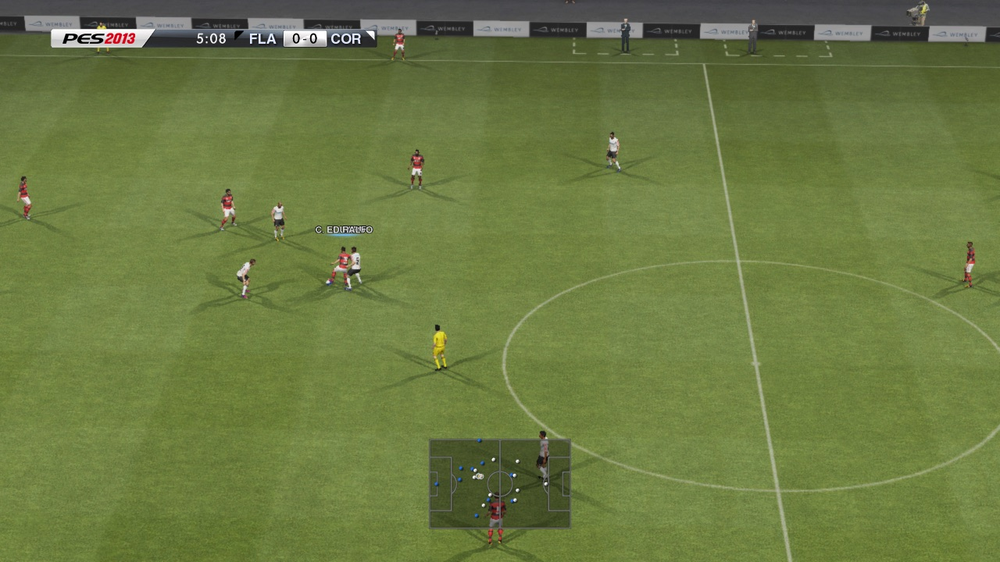
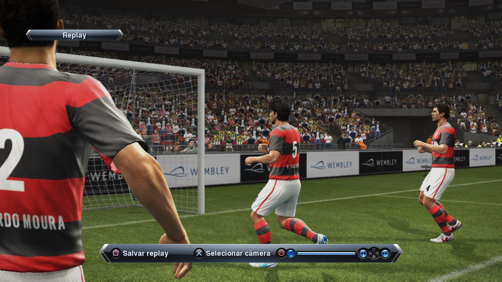
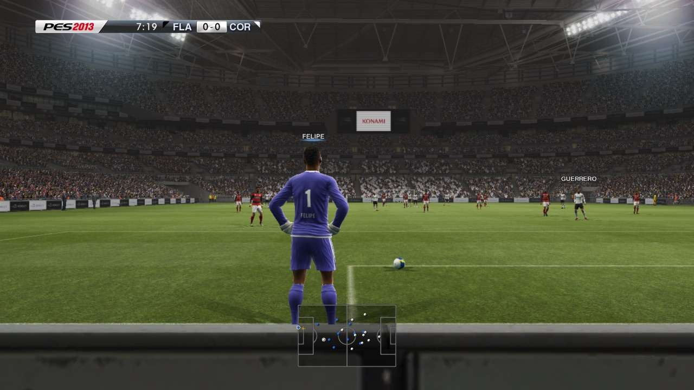
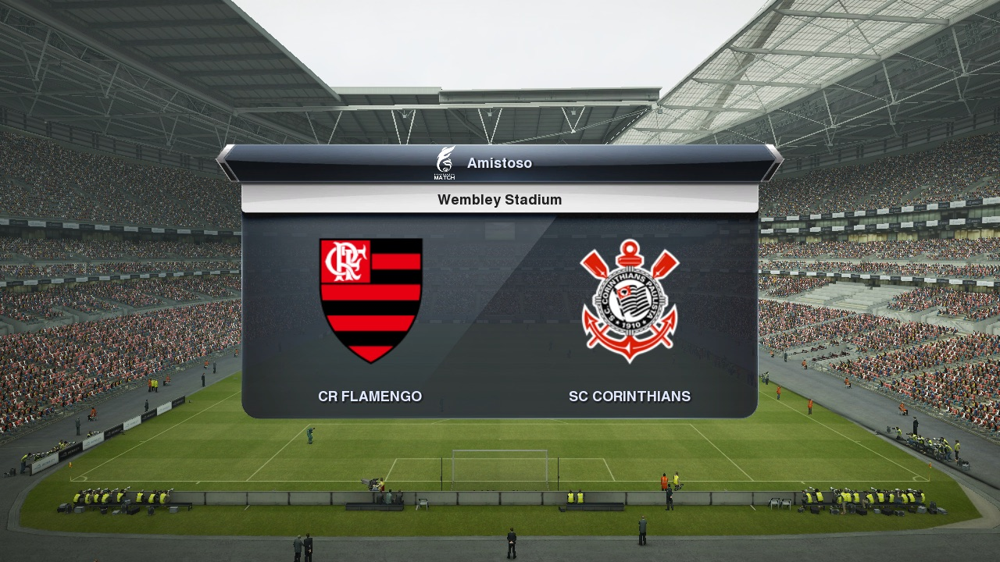

# PES 2013 — static recompilation for PC (macOS)

🌐 **English** · [Português (BR)](README.pt-BR.md)

A native port of **Pro Evolution Soccer 2013** (PS3, US disc `BLUS31029`,
updated to 01.04) to **macOS/arm64**, built with static recompilation: the
game's PowerPC and SPU code is translated to C/C++ and compiled into a native
executable, with graphics on Metal. It is not an emulator.

**It boots, shows its menus in Portuguese and plays full matches**, at a steady
60 fps in gameplay (headless measurement on Apple silicon, the game's 1280×720),
with Data Pack 6 and an Option File loaded. A friendly has been played to the
end in a window.

| | |
| --- | --- |
| [](docs/screenshots/01-gameplay-camera.jpg)<br>Gameplay camera | [](docs/screenshots/02-replay.jpg)<br>Replay |
| [](docs/screenshots/03-goal-kick-shadows.jpg)<br>Goal kick, shadows on the grass | [](docs/screenshots/04-match-card.jpg)<br>Match card |

<sub>Frames from the port itself (the RSX frame dump of a headless run) on an
Apple-silicon Mac, built from the player's own copy, at the game's 1280×720.
PES 2013 © Konami Digital Entertainment; club names and kits come from the
player's own Option File. Shown only to document the port.</sub>

Built on [ps3recomp](https://github.com/sp00nznet/ps3recomp) and on the
toolkit fixes made for the inFAMOUS, Resistance and Deadpool ports. See
[CREDITS.md](CREDITS.md).

> [!WARNING]
> **Alpha.** Runs only on Apple-silicon macOS. Master League, Become a Legend,
> online modes and long sessions have not been tested yet. What is missing is
> in [ROADMAP.md](ROADMAP.md).

> **This repository contains no game data, no firmware, no Sony keys and
> nothing translated from them.** Everyone generates all of that locally from
> their own legitimate copy. A fan project, not affiliated with Konami or Sony
> Interactive Entertainment.

## Status

| | |
| --- | --- |
| Boot, logos, title screen, first-run setup, menus in Portuguese | ✅ |
| Update 01.04, Data Pack 6, Option File (1106 saves: kits, emblems, faces) | ✅ |
| Team select, line-ups, anthem, kick-off | ✅ |
| Full friendly match, in a window | ✅ played to the end by Erik |
| Players in the gameplay camera (kits, keepers, referee) | ✅ since 2026-11-04 |
| Gameplay at 60 fps | ✅ 60.0 fps, p95 17.6 ms, ~133% CPU (headless, quiet machine, 2026-11-05) |
| Replays | ✅ 30 fps, which looks like the game's own pacing (the render thread is half idle) |
| Sound (48 kHz, game mixer) | ✅; 🧪 one frame of 0.1-0.2 s at the start of a replay still drops a few audio blocks |
| Internal resolution 1080p / 1440p / 4K, window modes, image filters, texture packs | ⏳ being ported from the inFAMOUS 2 and Resistance 2 toolkits |
| The app (launcher): play, graphics, controls, Option File profiles, saves | 🧪 built; not yet tested launching the game |
| Brazil 2026 rosters and kits | 🧪 tools and data collected; a Flamengo test save loads in the line-up screen |
| Master League, Become a Legend, saving a career | ❓ not tested |
| Online, trophies | ❓ offline only, not tested |
| Linux and Windows | ⏳ not planned yet |

Details and next steps in [ROADMAP.md](ROADMAP.md).

## What you need

- An Apple-silicon Mac (developed on 24 GB; the build needs about 25 GB free).
- Your own copy of PES 2013: the US disc image (`BLUS31029`), the 01.04 update
  PKG and, if you want it, Data Pack 6 and an Option File in PS3 save format.
- Xcode Command Line Tools, CMake, Ninja, SDL2 (Homebrew), Python 3.12.

## Building from source

```sh
tools/setup_toolkit.sh                 # the toolkit in ../ps3recomp-up-r8
ln -s <folder with the .iso> game_iso  # your disc image, mounted read-only
# put EBOOT.BIN, PARAM.SFO, ICON0.PNG and PS3LOGO.DAT from the 01.04 PKG in game/
tools/rebuild.sh                       # decrypt, analyse, lift PPU/SPU/jobs, build
```

- The decryption keys live outside the repository, in
  `~/Library/Application Support/pes13-recomp/keys/`. `tools/env.sh` says what
  goes there.
- **Build only with `tools/build.sh` or `tools/rebuild.sh`.** They run one build
  at a time and stop on low memory or disk; uncontrolled parallel compiles of
  the lifted code have crashed a 24 GB Mac.
- Option File: `tools/install_savedata.py SAVEDATA rpcs3/dev_hdd0/home/00000001/savedata --keys <file>`
  decrypts the one protected file (`BLUS31029EEDIT/DATA.BIN`). The key file's
  format is at the top of the script.

## Playing

```sh
tools/run.sh > cache/boot-meu.log 2>&1
```

`run.sh` mounts the disc image read-only, assembles the game's file tree under
`rpcs3/` and starts the game. Pass settings as `VAR=value` after it.

| Setting | What it does |
| --- | --- |
| `PS3_LANG=PT` | Console language (default `PT`; `pt-br` or `17` for Brazil). The first-run setup still asks for the game language |
| `PS3_ANISO=16` | Anisotropic filtering (default 16; `0` = the game's own) |
| `PS3_AA=fxaa`, `PS3_SHARPEN=0..1`, `PS3_DISPLAY_GAMMA` | Anti-aliasing, sharpening, gamma at present |
| `AUDIO_ELASTIC=1` | A 43 ms audio queue that waits for a late block (default; `0` = 21 ms) |
| `PS3_AUDIO_VOLUME=0..100`, `PS3_AUDIO_MUTE=1`, `PS3_AUDIO_DEVICE=<name part>` | Host audio level, mute, output device |
| `PS3RECOMP_METAL_FPS=1` | Frame-rate counter |
| `RSX_PACE_LOG=5`, `AUDIO_RATE=1` | Every 5 s: fps, frame-time percentiles, audio gaps (what to send with a report) |
| `PS3_VERBOSE=1` | The full runtime log (very large) |

Keyboard: Enter is START, Space is CROSS. A DualSense, DualShock 4 or Xbox
controller works through SDL.

## The app

[`launcher/`](launcher/README.md) is a desktop app (Tauri) that runs
`tools/run.sh` with your settings: Home, Graphics, Controls (labelled with
the football actions), Game, **Option File** (save profiles: the default
`rpcs3/` tree, copies, profiles installed from a PS3 save folder or a .zip)
and Advanced (rebuild, game log, debug mode). A control whose feature the
build does not have yet says so instead of doing nothing.

```sh
cd launcher && npm install && npm run tauri build
```

## Fixes made here

Most of the work is in the toolkit, shared with the other ports. Highlights:

- **Players invisible in the gameplay camera:** the far players' kits are baked
  into small main-memory render targets; the pixels stayed on the GPU, and the
  draw engine's surface table (64) filled up before kick-off and dropped draws
  silently. Write-back of small main-memory targets, and a 512-entry table.
- **Neon skin and black faces:** NV308A inline uploads stopped at 256 of 1792
  words, cutting every fragment program after 1 KB.
- **Striped kits:** linear mipmapped textures lost their pitch below level 0.
- **T-pose:** SPURS `JOBLIST` was not implemented, so animation never ran.
- **Exit after the title screen:** a vblank callback delivered inside another
  guest callback restarted at the top of the same stack.
- **Random freeze in a match:** the FIFO overrun fallback recycled the game's
  ring on a reading taken mid-update; now it needs 250 ms of no progress.
- **Performance (2026-11-05):** shadow depth converted on the GPU instead of
  two full GPU waits per frame; vertex constants staged by the rows a program
  reads; per-program memo; buffer pool; state bound only when it changes;
  thread QoS so the game stays on performance cores. From about 18 fps
  before this work to 60.

## Layout

| Folder | What it is |
| ------ | ---------- |
| `port/` | The CMake project: `main.cpp` (frame clock, vblank, QoS), `stubs.cpp`, `config.toml` |
| `tools/` | Build, run, lift, save installer, Option File and roster tools |
| [`launcher/`](launcher/README.md) | The desktop app |
| `docs/` | Inventory, compatibility, work list (pt-BR), Brazil 2026 data, screenshots |
| `patches/` | The toolkit changes this port needs, applied by `tools/setup_toolkit.sh` |

## License

Code in this repository: MIT ([LICENSE](LICENSE)). The toolkit is MIT by its
authors. Pro Evolution Soccer 2013 © Konami Digital Entertainment; this project
is not affiliated with Konami or Sony.
