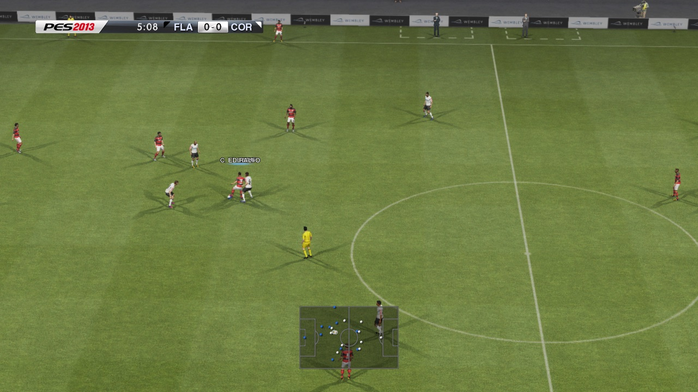
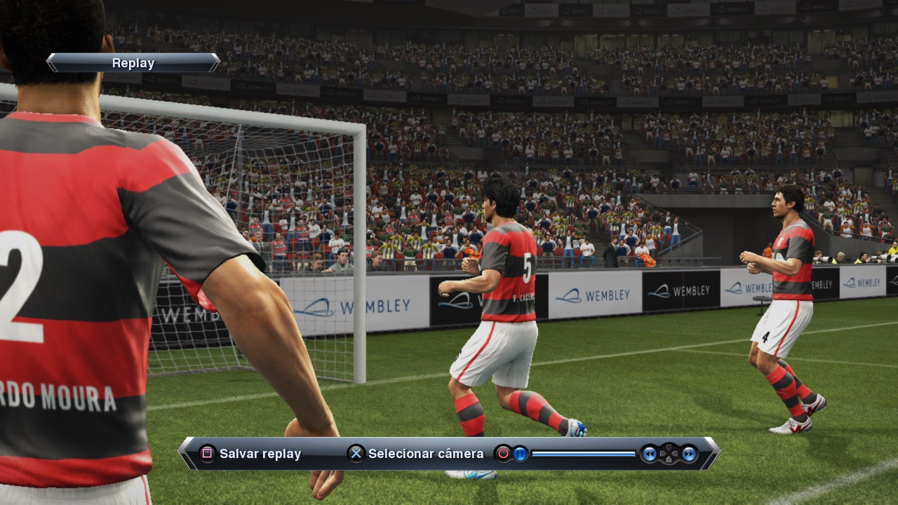
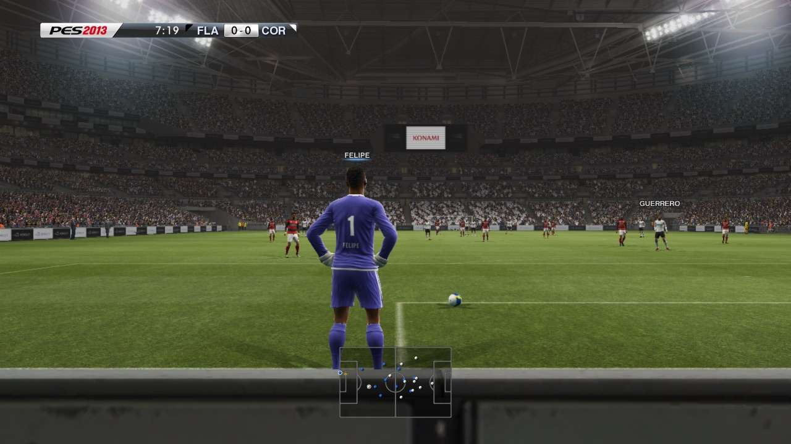
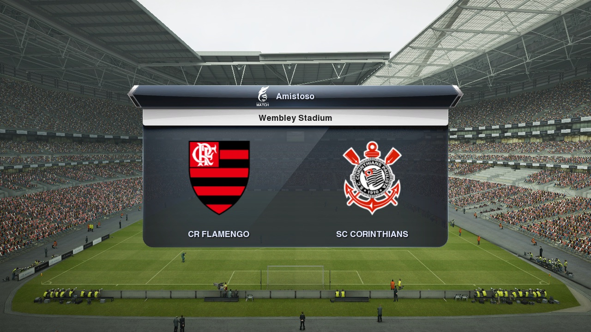

# PES 2013 — recompilação estática para PC (macOS)

🌐 [English](README.md) · **Português (BR)**

Um porte nativo de **Pro Evolution Soccer 2013** (PS3, disco americano
`BLUS31029`, atualizado para 01.04) para **macOS/arm64**, feito com recompilação
estática: o código PowerPC e SPU do jogo é traduzido para C/C++ e compilado num
executável nativo, com gráficos em Metal. Não é um emulador.

**Ele abre, mostra os menus em português e joga partidas completas**, a 60 fps
estáveis no jogo (medido sem janela num Mac Apple Silicon, nos 1280×720 do jogo),
com o Data Pack 6 e um Option File carregados. Um amistoso já foi jogado até o fim
em janela.

| | |
| --- | --- |
| [](docs/screenshots/01-gameplay-camera.jpg)<br>Câmera de jogo | [](docs/screenshots/02-replay.jpg)<br>Replay |
| [](docs/screenshots/03-goal-kick-shadows.jpg)<br>Tiro de meta, sombras no gramado | [](docs/screenshots/04-match-card.jpg)<br>Cartão da partida |

<sub>Quadros do próprio porte (a captura RSX de uma execução sem janela) num Mac
Apple Silicon, compilado a partir da cópia do jogador, nos 1280×720 do jogo.
PES 2013 © Konami Digital Entertainment; nomes e uniformes dos clubes vêm do
Option File do próprio jogador. Mostrados só para documentar o porte.</sub>

Feito sobre o [ps3recomp](https://github.com/sp00nznet/ps3recomp) e sobre as
correções do toolkit feitas para os portes de inFAMOUS, Resistance e Deadpool. Ver
[CREDITS.pt-BR.md](CREDITS.pt-BR.md).

> [!WARNING]
> **Alfa.** Roda só no macOS em Apple Silicon. Master League, Rumo ao Estrelato,
> modos online e sessões longas ainda não foram testados. O que falta está em
> [ROADMAP.pt-BR.md](ROADMAP.pt-BR.md).

> **Este repositório não contém dados do jogo, firmware, chaves da Sony nem nada
> traduzido deles.** Cada um gera tudo isso localmente a partir da própria cópia
> legítima. Projeto de fã, sem afiliação com a Konami ou a Sony Interactive
> Entertainment.

## Estado

| | |
| --- | --- |
| Boot, logos, tela de título, configuração inicial, menus em português | ✅ |
| Atualização 01.04, Data Pack 6, Option File (1106 saves: uniformes, escudos, rostos) | ✅ |
| Seleção de times, escalações, hino, pontapé inicial | ✅ |
| Amistoso completo, em janela | ✅ jogado até o fim pelo Erik |
| Jogadores na câmera de jogo (uniformes, goleiros, árbitro) | ✅ desde 2026-11-04 |
| Partida a 60 fps | ✅ 60,0 fps, p95 17,6 ms, ~133% de CPU (sem janela, máquina livre, 2026-11-05) |
| Replays | ✅ 30 fps, que parece ser o ritmo do próprio jogo (a thread de vídeo fica metade do tempo parada) |
| Som (48 kHz, mixer do jogo) | ✅; 🧪 um quadro de 0,1-0,2 s no início do replay ainda perde alguns blocos de áudio |
| Modos de janela (janela, sem borda, tela cheia), tamanho, monitor, vsync, MetalFX | 🧪 na build desde 2026-11-05, ainda não vistos em janela |
| Filtros de imagem (vibração, contraste, vinheta, granulação, LUT de cor) e pacotes de texturas | 🧪 na build desde 2026-11-05: testes de unidade e execuções sem janela (um pacote de teste trocou texturas da tela de título) |
| Resolução interna 1080p / 1440p / 4K (`PS3_RES_SCALE`) | 🧪 na build desde 2026-11-05; o fps de cada degrau ainda não foi medido. Ultrawide: ⏳ precisa de um patch de projeção |
| O app (launcher): jogar, gráficos, controles, perfis de Option File, saves | 🧪 compilado; ainda não testado abrindo o jogo |
| Perfil temporada 2026: Séries A e B com 20 clubes cada, clubes da Libertadores e da Sul-Americana, nomes, elencos, uniformes, escudos | 🧪 visto sem janela nos menus e seletores; ainda sem uma partida com ele |
| Posições e habilidades de 2026 | ✅ gravadas em todo jogador renomeado; 🧪 977 das cartas do eFootball 2026, os outros por um modelo de posição por enquanto |
| Gramado HD (4096x2048) | 🧪 os dois gramados vistos nas partidas, num pacote de texturas (`gramado-hd`) |
| Rostos reais de 2026 | 🧪 63 jogadores num pacote de texturas (Pulgar e Arrascaeta vistos); falta capturar mais |
| Fechar a janela encerra o jogo | ✅ desde 2026-11-06 (antes continuava rodando sem janela) |
| Master League, Rumo ao Estrelato, salvar uma carreira | ❓ não testado |
| Online, troféus | ❓ só offline, não testado |
| Linux e Windows | ⏳ ainda sem plano |

Detalhes e próximos passos em [ROADMAP.pt-BR.md](ROADMAP.pt-BR.md). A lista de
trabalho do dia a dia está em [docs/O_QUE_FALTA.md](docs/O_QUE_FALTA.md).

## O que você precisa

- Um Mac Apple Silicon (desenvolvido em 24 GB; a compilação precisa de uns 25 GB livres).
- Sua própria cópia do PES 2013: a imagem do disco americano (`BLUS31029`), o PKG
  da atualização 01.04 e, se quiser, o Data Pack 6 e um Option File em formato de
  save de PS3.
- Xcode Command Line Tools, CMake, Ninja, SDL2 (Homebrew), Python 3.12.

## Como compilar

```sh
tools/setup_toolkit.sh                 # o toolkit em ../ps3recomp-up-r8
ln -s <pasta com a .iso> game_iso      # sua imagem do disco, montada só para leitura
# coloque EBOOT.BIN, PARAM.SFO, ICON0.PNG e PS3LOGO.DAT do PKG 01.04 em game/
tools/rebuild.sh                       # decifra, analisa, converte PPU/SPU/jobs e compila
```

- As chaves de decifração ficam fora do repositório, em
  `~/Library/Application Support/pes13-recomp/keys/`. O `tools/env.sh` diz o que vai lá.
- **Compile só com `tools/build.sh` ou `tools/rebuild.sh`.** Eles rodam uma
  compilação por vez e param com pouca memória ou disco; compilações paralelas sem
  controle do código convertido já travaram um Mac de 24 GB.
- Option File: `tools/install_savedata.py SAVEDATA rpcs3/dev_hdd0/home/00000001/savedata --keys <arquivo>`
  decifra o único arquivo protegido (`BLUS31029EEDIT/DATA.BIN`). O formato do
  arquivo de chaves está no início do script.

## Como jogar

```sh
tools/run.sh > cache/boot-meu.log 2>&1
```

O `run.sh` monta a imagem do disco só para leitura, monta a árvore de arquivos do
jogo em `rpcs3/` e abre o jogo. Passe ajustes como `VAR=valor` depois dele.

| Ajuste | O que faz |
| --- | --- |
| `PS3_LANG=PT` | Idioma do console (padrão `PT`; `pt-br` ou `17` para Brasil). A configuração inicial ainda pergunta o idioma do jogo |
| `PS3_ANISO=16` | Filtro anisotrópico (padrão 16; `0` = o do jogo) |
| `PS3_AA=fxaa`, `PS3_SHARPEN=0..1`, `PS3_DISPLAY_GAMMA` | Antisserrilhado, nitidez, gama na apresentação |
| `AUDIO_ELASTIC=1` | Fila de áudio de 43 ms que espera um bloco atrasado (padrão; `0` = 21 ms) |
| `PS3_AUDIO_VOLUME=0..100`, `PS3_AUDIO_MUTE=1`, `PS3_AUDIO_DEVICE=<parte do nome>` | Volume, mudo e saída de som do Mac |
| `PS3_WINDOW_MODE=windowed\|borderless\|fullscreen`, `PS3_WINDOW_SIZE=LxA`, `PS3_DISPLAY=<n ou nome>`, `PS3_VSYNC=0` | A janela (Cmd+F alterna a tela cheia) |
| `PS3_UPSCALE=metalfx` | Upscaling espacial MetalFX até o tamanho em pixels da janela |
| `PS3_VIBRANCE`, `PS3_CONTRAST`, `PS3_VIGNETTE`, `PS3_GRAIN`, `PS3_LUT=<png>`, `PS3_LUT_STRENGTH`, `PS3_LUT_PRESET=warm\|cool\|film\|vivid` | Filtros de imagem (todos desligados por padrão) |
| `PS3_MODS_DIR=<pasta>`, `PS3_MODS=<pacote,pacote>`, `PS3_MODS_DUMP=<pasta>` | Pacotes de texturas (`<chave de 16 hex>.png`, o primeiro pacote vence) e a exportação das texturas para começar um |
| `PS3RECOMP_METAL_FPS=1` | Contador de fps |
| `RSX_PACE_LOG=5`, `AUDIO_RATE=1` | A cada 5 s: fps, tempos de quadro e buracos no áudio (o que mandar junto com um relato) |
| `PS3_VERBOSE=1` | O log completo do runtime (muito grande) |

Teclado: Enter é START, Espaço é CROSS. DualSense, DualShock 4 ou controle de Xbox
funcionam pelo SDL.

## Perfil temporada 2026

Um perfil de teste (uma cópia; os saves do dono não são tocados), montado com os
scripts `tools/*_2026.py` a partir de fontes públicas (súmulas da CBF, elencos
da ESPN, escudos da Wikipédia/Wikimedia, pacotes de uniformes e faces da
comunidade):

- Séries A e B de 2026 com 20 clubes cada (o Option File original tem 18 vagas
  na Série B; `port/pes_leagues.cpp` lê o layout de 20).
- Nomes dos clubes em todos os idiomas do jogo; elencos de 2026 (nomes, nomes na
  camisa, números) dos 40 clubes brasileiros e de 49 clubes da Libertadores e da
  Sul-Americana; a lista da Libertadores e a liga sul-americana trocadas.
- Uniformes 1 e 2 de 2026 dos 40 clubes e escudos dos clubes que faltavam ou
  estavam na vaga de outro, como pacotes de texturas.
- Nenhum jogador usa mais o rosto de outro: 14 voltaram a ter o próprio rosto,
  os outros um rosto fictício; outros 63 usam o rosto real de 2026, de pacotes de
  faces do PES 2013 de PC, como pacote de texturas (`faces-2026`).
- Posições, habilidades, pé, altura, idade e nacionalidade gravadas em todo jogador
  renomeado, calibradas para a escala do PES 2013: das cartas de 2026 do eFootball
  (pesdb.net) onde já coletadas, um modelo por posição no resto.
- Os 20 estádios do criador de estádios têm nomes de 2026 (só os nomes).

Texturas em HD: a imagem de um pacote pode ser maior que a textura que ela
substitui (o pacote de escudos é 256x256 sobre 128x128). Então uniformes,
escudos, rostos e gramado podem entrar em resolução maior, vinda das fontes. Os
rostos dos pacotes do PES 2013 de PC (mesmo layout, 1024 ou 2048) entram em 512x1024
ou 1024x2048, de duas a quatro vezes os 256x512 do PS3.

## O app

O [`launcher/`](launcher/README.md) é um app de desktop (Tauri) que roda o
`tools/run.sh` com os seus ajustes: Início, Gráficos, Controles (com as ações de
futebol), Jogo, **Option File** (perfis de save: a árvore padrão `rpcs3/`, cópias,
perfis instalados de uma pasta de saves do PS3 ou de um .zip) e Avançado
(recompilar, log do jogo, modo de depuração). Um controle cuja função a build ainda
não tem avisa isso, em vez de não fazer nada.

```sh
cd launcher && npm install && npm run tauri build
```

## Correções feitas aqui

A maior parte do trabalho está no toolkit, compartilhado com os outros portes.
Principais:

- **Jogadores invisíveis na câmera de jogo:** os uniformes dos jogadores distantes
  são reduzidos para alvos pequenos na memória principal; os pixels ficavam na GPU,
  e a tabela de superfícies do motor (64) enchia antes do apito e descartava
  desenhos em silêncio. Agora esses alvos voltam para a memória e a tabela tem 512.
- **Pele neon e rostos pretos:** os envios em linha do NV308A paravam em 256 de
  1792 palavras, cortando todo fragment program depois de 1 KB.
- **Uniforme em faixas:** texturas lineares com mipmaps perdiam o pitch abaixo do nível 0.
- **Pose T:** o `JOBLIST` do SPURS não estava implementado, então a animação nunca rodava.
- **Fechamento depois da tela de título:** um callback de vblank entregue dentro de
  outro callback do jogo recomeçava no topo da mesma pilha.
- **Travamento aleatório na partida:** a saída de emergência da FIFO reciclava o
  anel do jogo com uma leitura feita no meio de uma atualização; agora exige 250 ms
  sem progresso.
- **Desempenho (2026-11-05):** a profundidade das sombras é convertida na GPU, em vez
  de duas esperas completas pela GPU por quadro; as constantes de vértice vão só com
  as linhas que o programa lê; memo por programa; pool de buffers; estado enviado só
  quando muda; QoS das threads para o jogo ficar nos núcleos de desempenho. De uns
  18 fps antes desse trabalho para 60.

## Organização

| Pasta | O que é |
| ------ | ---------- |
| `port/` | O projeto CMake: `main.cpp` (relógio de quadros, vblank, QoS), `stubs.cpp`, `config.toml` |
| `tools/` | Compilar, rodar, converter, instalar saves, ferramentas de Option File e elencos |
| [`launcher/`](launcher/README.md) | O app de desktop |
| `docs/` | Inventário, compatibilidade, lista de trabalho, dados Brasil 2026, capturas |
| `patches/` | As mudanças no toolkit de que este porte precisa, aplicadas pelo `tools/setup_toolkit.sh` |

## Licença

Código deste repositório: MIT ([LICENSE](LICENSE)). O toolkit é MIT pelos seus
autores. Pro Evolution Soccer 2013 © Konami Digital Entertainment; este projeto não
tem afiliação com a Konami nem com a Sony.
